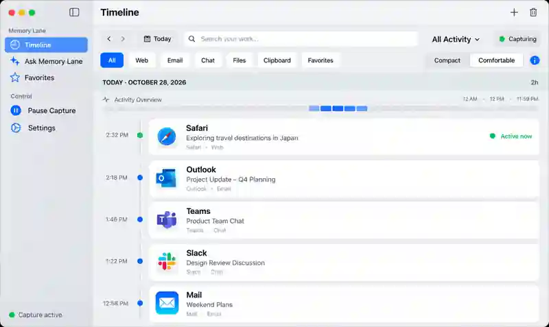
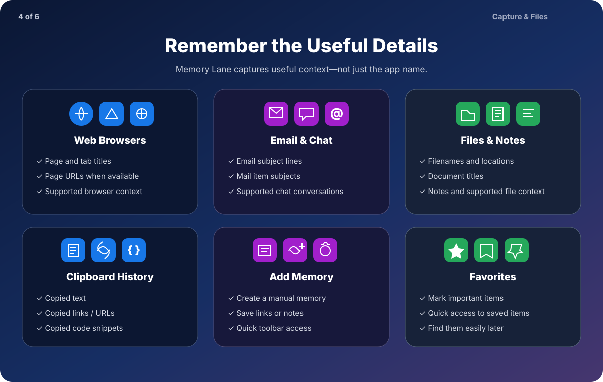
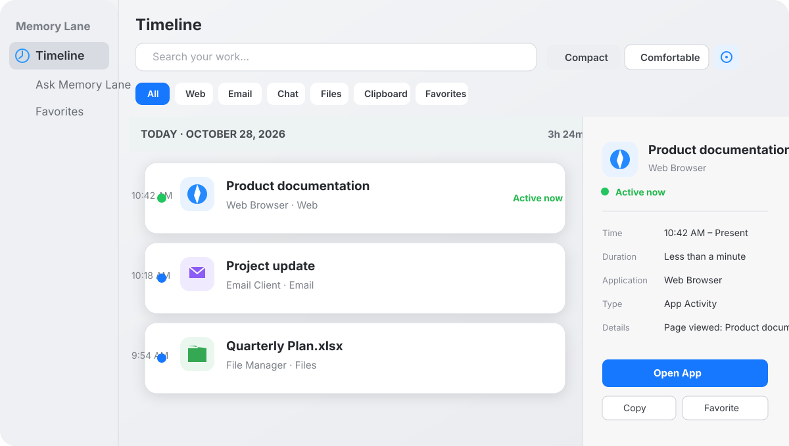

# Memory Lane

**Memory Lane** is a private, local-first macOS activity timeline that helps you remember what you were doing on your Mac.

It quietly captures useful context from supported applications—such as browser page titles, email subjects, chat windows, filenames, document names, clipboard text, and focused application activity—and organizes it into a chronological, searchable timeline.

Instead of digging through browser history, inboxes, chats, recent files, and multiple apps, Memory Lane gives you one place to retrace your digital workday.

> Memory Lane is designed to preserve the actual context your Mac exposes—such as an email subject, page title, filename, or window title—rather than rewriting or summarizing your timeline.

---

## Screenshots

### Memory Lane App UI



### Capture & Files Tutorial



### Timeline Details



_All preview content shown above is generic demo data._

---

## What Problem Does Memory Lane Solve?

During a normal workday, information becomes scattered across:

- Browser tabs
- Outlook and Apple Mail
- Microsoft Teams
- Finder
- Word, Excel, and PowerPoint
- OneNote
- Preview
- Clipboard history
- Notes and manually saved reminders

Hours later, you may remember that you saw something—but not where.

Memory Lane is built to answer questions like:

- What webpage was I looking at earlier?
- What Outlook email did I open before that meeting?
- Which spreadsheet was I working on this morning?
- What file did I have open before switching to Teams?
- What did I copy to my clipboard?
- What was I doing around 10:30 AM?
- What did I work on yesterday afternoon?
- Which items did I mark as important?

Memory Lane keeps that context locally and makes it easy to retrace.

---

## Core Features

### 1. Chronological Activity Timeline

Memory Lane builds a timestamped timeline of your Mac activity.

Depending on the application and the information macOS makes available, an entry may include:

- Application name
- Window title
- Page or tab title
- Email subject
- Conversation or chat context
- Filename
- Document title
- File path
- URL
- Timestamp
- Duration
- Activity type
- Previous activity
- Favorite status

The goal is to show enough context for you to immediately recognize what you were working on.

### Timeline Filters

You can quickly narrow the timeline using categories such as:

**All · Web · Email · Chat · Files · Clipboard · Favorites**

Memory Lane also supports **Compact** and **Comfortable** timeline layouts.

### Detailed Inspector

Double-click a timeline item to open its details in the right-side inspector.

The inspector can show available information such as:

- Time
- Duration
- Application
- Activity type
- Captured title or subject
- Source URL
- File path
- Previous activity
- Open App action
- Copy action
- Favorite action

The Details panel can also be hidden when you want more space for the timeline.

---

## App-Aware Activity Capture

Memory Lane does more than simply record that an application was open.

It attempts to capture the meaningful context inside supported apps using macOS Accessibility APIs and application metadata.

### Web Browsers

For supported browsers, Memory Lane can capture page and tab context when it is available.

Supported examples include:

- Safari
- Google Chrome
- Mozilla Firefox

Captured browser context may include:

- Page title
- Tab title
- URL when available
- Browser name
- Time viewed

Example:

**Safari — Cisco Room Bar Configuration Guide**

instead of simply:

**Safari**

This makes browser history much more useful when searching your timeline later.

---

## Email Capture

Memory Lane can capture subject-level context from supported email applications.

### Microsoft Outlook

Memory Lane attempts to capture the selected Outlook email subject rather than generic Outlook window text or unrelated URL information.

Example:

**Outlook — Incident Update | PH2**

### Apple Mail

For Apple Mail, Memory Lane can record the mail window or message context exposed by macOS.

Example:

**Mail — RE: Data Center Staffing Plan**

The purpose is to help you recognize the message you viewed without storing or summarizing the entire email body.

---

## Chat and Collaboration

### Microsoft Teams

Memory Lane can capture useful Teams window or conversation context when it is exposed by the application.

Example:

**Teams — John Smith | Project Phoenix**

This allows Teams activity to appear alongside browser, email, and file activity in the same timeline.

---

## Files, Documents, and Notes

Memory Lane can capture document names, filenames, paths, and window context from supported applications.

Examples include:

- Finder
- Microsoft Word
- Microsoft Excel
- Microsoft PowerPoint
- Preview
- OneNote

This makes it easier to answer questions such as:

- Which spreadsheet did I work on yesterday?
- What PDF did I have open before lunch?
- Where was that file located?
- Which OneNote page was I viewing?

When a usable path or source is available, Memory Lane can preserve it with the activity.

---

## Ask Memory Lane

**Ask Memory Lane** lets you search your local activity history using natural-language-style questions.

Examples:

- What was I doing around 10:30 AM?
- What did I view before opening Teams?
- Find the Outlook email I viewed today
- Find the spreadsheet I worked on yesterday
- Show me Safari activity from this morning
- What file did I open after Outlook?
- Show my favorite items from this week

Ask Memory Lane can use captured information such as:

- Timestamps
- Application names
- Page titles
- Email subjects
- Conversation names
- Filenames
- File paths
- URLs
- Before/after relationships

Searches run against the activity stored locally by Memory Lane.

---

## Activity Overview

The Timeline includes an **Activity Overview** strip that provides a visual representation of activity across the day.

It can help you quickly identify:

- Busy periods
- Quiet periods
- Long stretches of activity
- Approximate work sessions
- Areas of the day you may want to inspect more closely

The overview is designed as a navigation aid—not an AI-generated summary.

---

## Clipboard History

Clipboard capture is enabled by default and can be disabled in Settings.

Memory Lane can remember supported copied content such as:

- Text
- URLs
- Code snippets

Large, unsupported, or non-text clipboard content may be ignored.

Clipboard history gives you another way to recover information that may no longer be visible in the application where you originally copied it.

---

## Manual Memories

Not everything important happens automatically.

The **Add Memory** feature lets you manually save information directly into your timeline.

Manual memories can be used for:

- Notes
- Links
- Reminders
- Important context
- Temporary information
- Anything you want to preserve alongside automatically captured activity

Manual entries become part of the same chronological history as captured activity.

---

## Favorites

Any supported Timeline item can be marked as a **Favorite**.

Favorites provide quick access to important items such as:

- Web pages
- Emails
- Files
- Notes
- Clipboard entries
- Manual memories
- Other timeline events

Use the Favorites filter to quickly return to important activity without searching the entire timeline.

---

## Preserves Context Instead of Summarizing It

Memory Lane is intentionally designed to preserve the original context it captures.

For example, if Outlook exposes:

**Incident Update | PH2**

Memory Lane should show that subject instead of replacing it with an AI-generated description.

Likewise, a browser page titled:

**Cisco Room Bar Configuration Guide**

should remain recognizable as that title in the timeline.

This makes Memory Lane a retracing tool rather than a generated activity report.

---

## Privacy & Local-First Design

Memory Lane is built around a **local-first** approach.

### Your Activity Stays on Your Mac

- Timeline history is stored locally using SwiftData.
- No Memory Lane account is required.
- No advertising SDK is included.
- No analytics SDK is included.
- Memory Lane does not require a cloud service to maintain your timeline.

### Pause Capture

Capture can be paused and resumed whenever needed.

### App Exclusions

You can choose applications that Memory Lane should ignore.

Sensitive applications such as:

- Passwords
- Wallet

are excluded by default.

### Clipboard Control

Clipboard capture can be disabled at any time in Settings.

### Clear App Cache

Memory Lane includes a cache reset option that can clear capture state and preferences without intentionally deleting your timeline history.

These controls are intended to give the user direct control over what Memory Lane records.

---

## Accessibility Permission

Memory Lane uses macOS **Accessibility** permission to retrieve detailed focused-window information from supported applications.

Without Accessibility permission:

- Memory Lane can still launch.
- Basic application activity may still be available.
- Detailed window context may be limited.
- Outlook subjects may not be available.
- Browser titles may be limited.
- Supported file and chat context may be unavailable.

Permission can be managed at:

**System Settings → Privacy & Security → Accessibility**

Memory Lane checks for the permission when detailed capture requires it.

---

## Menu Bar Operation

Memory Lane can continue running from the macOS menu bar without keeping the main window open.

Menu bar controls provide quick access to actions such as:

- Open Memory Lane
- Pause Capture
- Resume Capture
- Open Settings
- Quit Memory Lane

This allows Memory Lane to remain available throughout the workday without occupying space on the desktop.

---

## Welcome Tutorial

A built-in onboarding experience introduces the application's major features.

The tutorial covers:

1. What Memory Lane is
2. How the timeline works
3. Ask Memory Lane
4. Browser activity
5. Email activity
6. Chat activity
7. Files and documents
8. Notes
9. Clipboard history
10. Manual memories
11. Favorites
12. Privacy controls
13. Accessibility permission

The tutorial can be replayed later from:

**Settings → Help**

---

## Typical Workflow

A normal day with Memory Lane might look like this:

1. You open Safari and research a technical issue.
2. Memory Lane records the page title.
3. You switch to Outlook and read an incident email.
4. Memory Lane records the selected subject.
5. You open Teams and review a conversation.
6. Memory Lane records the available chat context.
7. You open a spreadsheet in Excel.
8. Memory Lane records the document name.
9. You copy a command or URL.
10. Memory Lane adds it to clipboard history.
11. Later, you search Memory Lane for what you were doing earlier.
12. You open the relevant timeline item and recover the context.

The result is a single timeline that connects activity across applications.

---

## Example Timeline

A Memory Lane timeline might contain entries such as:

```text
09:12  Safari       Cisco Room Bar Configuration Guide
09:24  Outlook      Incident Update | PH2
09:31  Teams        John Smith | Project Phoenix
09:47  Excel        FY27 Capacity Planning.xlsx
10:03  Finder       /Projects/Datacenter/Capacity
10:08  Clipboard    show interface status
10:22  OneNote      Network Migration Notes
```

Instead of remembering which application contained the information, you can retrace the sequence of work.

---

## Designed For

Memory Lane can be useful for people who frequently move between many applications and need to reconstruct what they were doing, including:

- IT professionals
- Engineers
- Operations teams
- Project managers
- Analysts
- Developers
- Researchers
- Knowledge workers
- Anyone managing multiple parallel tasks

It is especially useful when your workday involves frequent context switching.

---

## What Memory Lane Is Not

Memory Lane is not intended to be:

- Employee monitoring software
- A screen recorder
- A keylogger
- A cloud surveillance service
- An AI-generated daily activity summary
- A replacement for application-specific history

It is designed as a personal activity-retracing tool controlled by the person using the Mac.

---

## Requirements

- macOS 14 or later
- Accessibility permission for detailed activity capture
- Xcode 16+ only if building from source

---

## Download

Download the current macOS DMG from the latest release:

**[Memory Lane v1.0](https://github.com/ram1424/Memory-Lane/releases/tag/v1.0)**

Direct DMG:

**[MemoryLane-1.0.dmg](https://github.com/ram1424/Memory-Lane/releases/download/v1.0/MemoryLane-1.0.dmg)**

---

## Website

Memory Lane also has a GitHub Pages site:

https://ram1424.github.io/Memory-Lane/

---

## Building From Source

1. Clone the repository.
2. Open `Memory Lane.xcodeproj` in Xcode.
3. Select the **Memory Lane** scheme.
4. Build and run the macOS target.
5. Grant Accessibility permission when required for detailed capture.

Bundle identifier:

```text
com.ram1424.memorylane
```

---

## Project Philosophy

Memory Lane is built around one simple question:

> **“What was I doing?”**

Modern work is spread across browsers, email, chat, documents, notes, files, and copied information. Memory Lane brings those fragments together into one private chronological history so you can retrace the context of your day without relying on memory alone.
