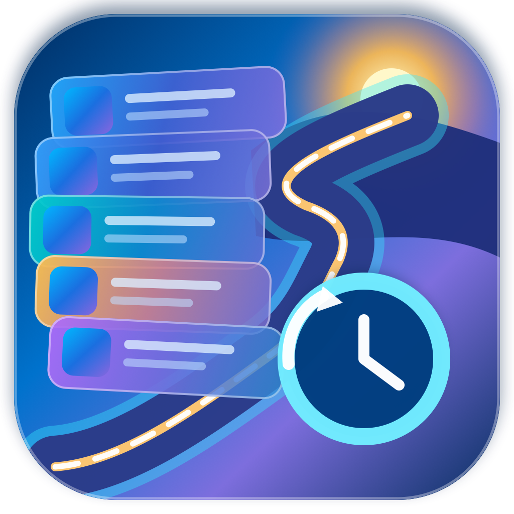
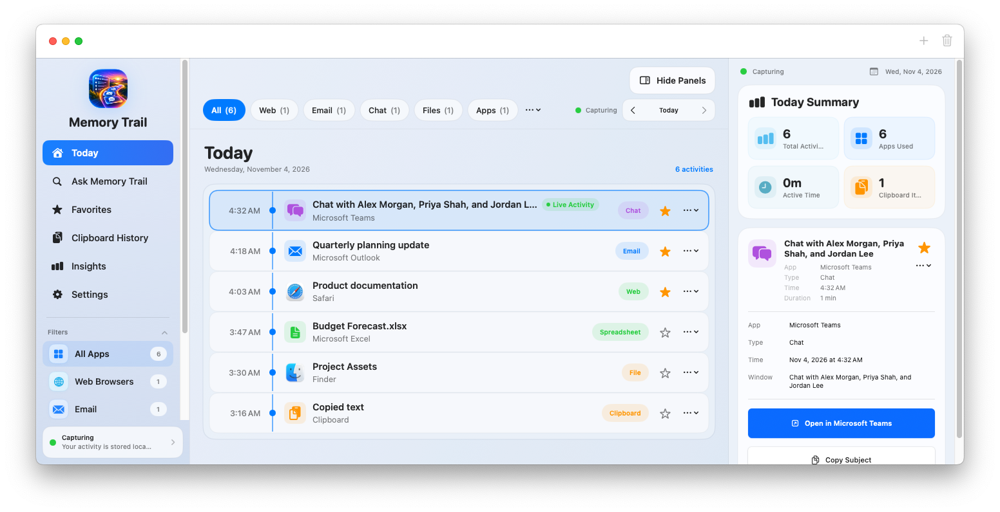
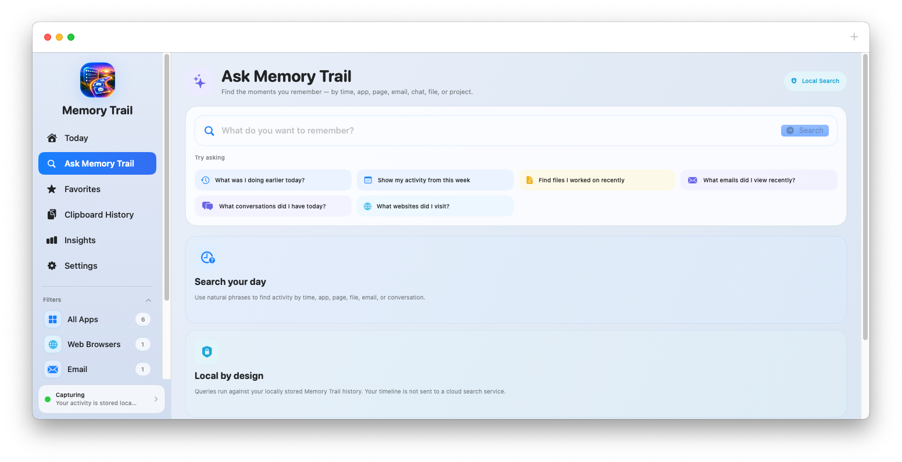
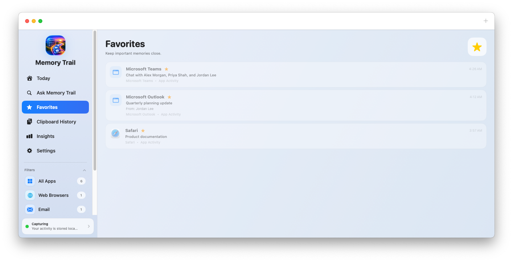

# Memory Trail

> **Privacy Policy:** [Read the Memory Trail Privacy Policy](PRIVACY.md)

  

<strong>Your workday, remembered locally.</strong>

Memory Trail is a privacy-first macOS activity timeline for retracing what you were doing across browsers, email, chat, files, documents, and the clipboard. It turns useful local app/window context into a searchable chronological history without requiring a cloud account or external data connector.

**Current release: Memory Trail 1.0 (Build 1) — First Official Release**

## Download

[Download Memory Trail 1.0 for macOS](https://github.com/ram1424/Memory-Trail/releases/latest/download/MemoryTrail-1.0.dmg)

Requires **macOS 14 or later**. Detailed window and activity capture requires macOS Accessibility permission.

## What Memory Trail Does

- **Live activity timeline** with the newest activity first
- **Ask Memory Trail** search across locally stored history
- **Browser context** including page/tab titles and URLs when exposed by supported browsers
- **Outlook and Mail context** including subject-level activity when available
- **Teams context** including supported conversation/window titles
- **Chat context** for Slack, Discord, Zoom, Webex, Signal, WhatsApp, Telegram, Mattermost, Google Chat, Messages, and other compatible chat apps when useful conversation context is exposed
- **Files and documents** from Finder and supported productivity apps
- **Clipboard history** for supported copied text, links, and code when enabled
- **Favorites** for important timeline entries
- **Manual memories** for notes and references you want to save yourself
- **App/process exclusions** so selected software is not recorded
- **Pause capture** control
- **Menu bar operation**
- **Insights and dynamic timeline filters**
- **Built-in update checking** from the Memory Trail app menu plus periodic automatic checks
- **First-launch What's New** release overview
- **Local SwiftData storage**
- **Privacy-focused onboarding and Settings controls**
- **No AI timeline summarization**

## Screenshots

### Today

### Ask Memory Trail

### Favorites

_All screenshots use generic demo data._

## Privacy

Memory Trail is designed around a simple principle: **your captured activity history stays on your Mac.**

### Local capture and storage

- Activity is sourced from local macOS application/window context and supported local metadata.
- Captured history is processed locally.
- Captured history is stored locally on the Mac using SwiftData.
- Clipboard history is local and can be disabled at any time.

### No external data pipeline

- **No cloud timeline sync**
- **No external data connectors**
- **No Memory Trail account**
- **No remote account required for capture**
- **No analytics SDK**
- **No advertising SDK**
- **No transmission of captured timeline history to an external service**
- **No AI-generated summaries of your timeline**

### User controls

- Pause all capture at any time.
- Enable or disable clipboard capture.
- Exclude installed apps and processes from capture.
- Passwords and Wallet are excluded by default.
- Clear cached capture state/preferences without deleting activity history.
- Review the source code in this repository to verify capture, storage, and privacy behavior.

Memory Trail is intended as a personal productivity and activity-retracing tool. It is **not** designed as employee monitoring software, a keylogger, or a screen recorder.

## Accessibility Permission

Memory Trail uses macOS Accessibility access to read the active application and supported focused-window titles so it can build a useful local timeline.

Enable it under:

**System Settings → Privacy & Security → Accessibility**

If Memory Trail does not appear automatically, use the **+** button to add **Memory Trail.app**, enable it, and relaunch the app.

## Data Sources

Depending on the app and what macOS exposes, Memory Trail can retain useful context such as:

- Active application names
- Focused window titles
- Browser page/tab titles and URLs
- Email subject lines
- Supported chat/conversation titles
- Folder, file, and document names/paths
- Copied text, links, and code when clipboard capture is enabled

Memory Trail records metadata/context exposed by supported apps; it is not a screen recorder.

## Build From Source

1. Clone this repository.
2. Open **Memory Trail.xcodeproj** in Xcode.
3. Select the **Memory Trail** scheme.
4. Build and run the macOS target.
5. Grant Accessibility permission when prompted.

**Bundle identifier:** `com.ram1424.memorytrail`  
**Marketing version:** `1.0`  
**Build:** `1`

## Release

Only the current production release is retained on the GitHub Releases page.

**Memory Trail 1.0 (Build 1) — First Official Release** is the current macOS release.
