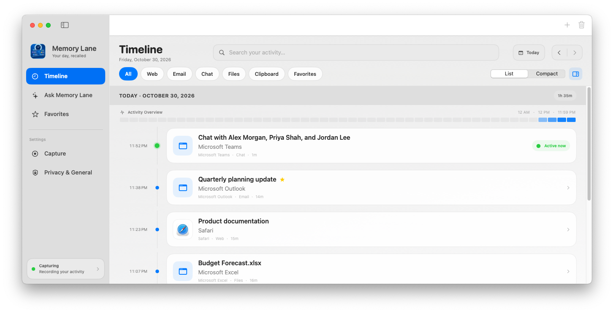
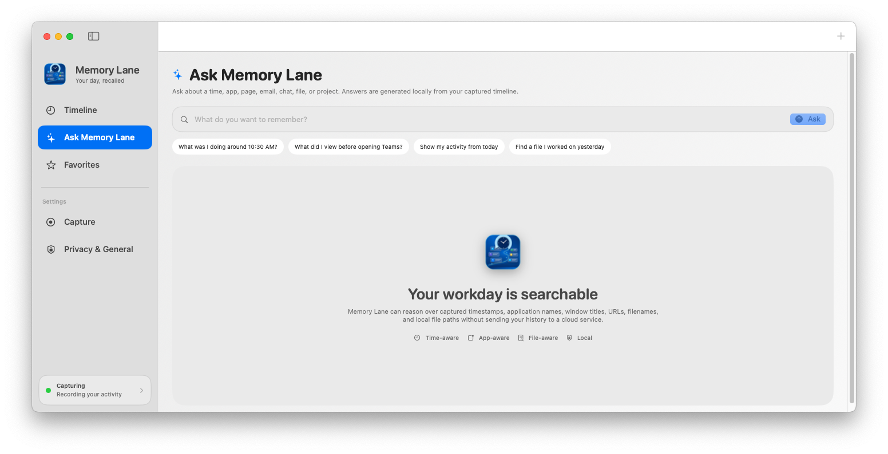
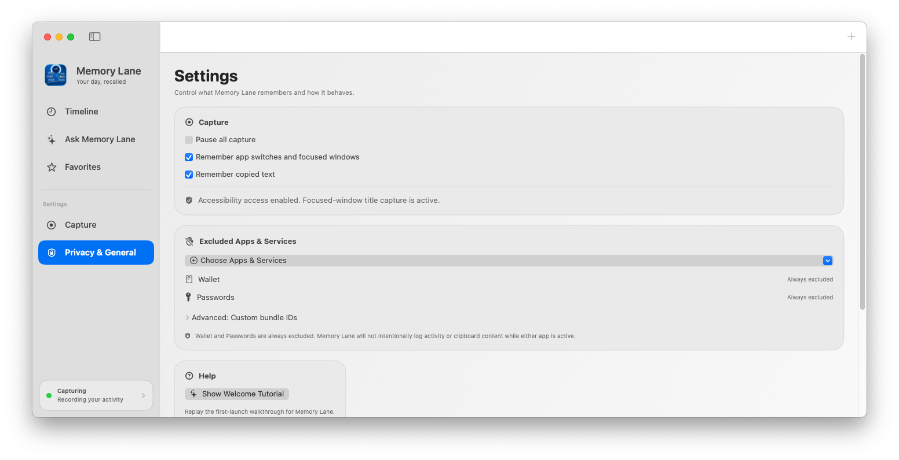

# Memory Lane

**Memory Lane** is a private, local-first macOS activity timeline for retracing what you were doing across your Mac.

It captures useful context that applications expose—such as browser page titles, Outlook email subjects and senders, Teams conversations, filenames, document names, file paths, URLs, clipboard text, and focused app activity—and organizes it into a clean chronological history.

Memory Lane is designed to preserve recognizable context rather than rewrite your day into AI-generated summaries.

---

## Screenshots

### Timeline



### Ask Memory Lane



### Privacy & General



_All screenshots use generic demo data._

---

## What Memory Lane Does

Memory Lane helps answer the question:

> **What was I doing?**

Instead of checking browser history, email, chats, recent documents, Finder, and the clipboard separately, Memory Lane brings the useful context together in one local timeline.

You can use it to retrace things like:

- the page you were viewing earlier;
- the Outlook email you opened before a meeting;
- the Teams conversation you switched to;
- the document or spreadsheet you were editing;
- the file or folder you had open;
- something you copied to the clipboard;
- what happened before or after another activity;
- what you were doing around a specific time.

---

## Highlights

### Chronological Timeline

Memory Lane records timestamped activity and presents it in a polished macOS timeline with:

- **All, Web, Email, Chat, Files, Clipboard, and Favorites** filters;
- **Compact** and **Comfortable** layouts;
- an **Activity Overview** strip;
- an optional right-side **Details** panel;
- double-click selection;
- duration estimates;
- favorite, copy, and open-in-app actions.

### Ask Memory Lane

Ask Memory Lane searches the local timeline using natural-language-style questions.

Examples:

- **What was I doing around 10:30 AM?**
- **What did I view before opening Teams?**
- **Show my activity from today**
- **Find a file I worked on yesterday**
- **Find the Outlook email from Jordan about project planning**

Outlook searches are sender- and subject-aware, with stronger ranking for exact phrases and combined sender/subject matches.

### App-Aware Capture

Memory Lane tries to capture the meaningful item inside supported apps rather than only the application name.

**Browsers**
- Safari
- Chrome
- Firefox and other supported browsers
- page/tab titles and URLs when available

**Email**
- Microsoft Outlook
- Apple Mail
- subject-level context
- Outlook sender information when available

**Chat**
- Microsoft Teams
- selected conversation names
- group participant names when Teams exposes them through Accessibility
- safe fallback to Teams' collapsed label when participant details are unavailable

**Files & documents**
- Finder
- Word
- Excel
- PowerPoint
- Preview
- OneNote
- filenames, paths, document names, and supported window context

### Clipboard History

Clipboard capture is enabled by default and can remember supported:

- text;
- URLs;
- code snippets.

It can be disabled at any time in Settings.

### Manual Memories & Favorites

Use **Add Memory** to save a note or link manually, and mark important timeline items as **Favorites** for quick retrieval later.

---

## Privacy by Design

Memory Lane is built as a **local-first** Mac app.

- Timeline history is stored locally with SwiftData.
- No Memory Lane account is required.
- No advertising SDK is included.
- No analytics SDK is included.
- Capture can be paused at any time.
- Apps can be excluded from capture.
- Passwords and Wallet are excluded by default.
- Clipboard capture can be disabled.
- Ask Memory Lane searches your local history.

Memory Lane is intended as a personal activity-retracing tool—not employee monitoring software, a keylogger, a screen recorder, or a cloud surveillance service.

---

## Accessibility Permission

Detailed capture relies on macOS **Accessibility** permission.

Go to:

**System Settings → Privacy & Security → Accessibility**

If Memory Lane does not appear automatically:

1. Click the **+** button below the Accessibility app list.
2. Authenticate if macOS requests it.
3. Choose **Applications → Memory Lane** and click **Open**.
4. Turn **Memory Lane** on.
5. Relaunch Memory Lane if macOS requests it.

Without Accessibility permission, basic application activity may still be available, but detailed browser, Outlook, Teams, file, and window context can be limited.

---

## Performance

Memory Lane uses event-driven capture for app activation and user interaction where possible, with throttled background polling and lazy timeline rendering to keep the interface responsive as history grows.

---

## Menu Bar Operation

Memory Lane can continue running from the macOS menu bar. The menu bar provides quick access to pause/resume capture and quit the app while the main window remains closed.

---

## Requirements

- macOS 14 or later
- Accessibility permission for detailed activity context
- Xcode 16+ only when building from source

---

## Download

Download the latest build from:

**[Memory Lane Releases](https://github.com/ram1424/Memory-Lane/releases/latest)**

---

## Building From Source

1. Clone this repository.
2. Open **Memory Lane.xcodeproj** in Xcode.
3. Select the **Memory Lane** scheme.
4. Build and run the macOS target.
5. Grant Accessibility permission when prompted.

Bundle identifier:

```text
com.ram1424.memorylane
```

---

## Project Philosophy

Modern work is spread across browsers, email, chat, documents, notes, files, and copied information. Memory Lane brings those fragments together into one private chronological history so you can retrace the context of your day without relying on memory alone.
